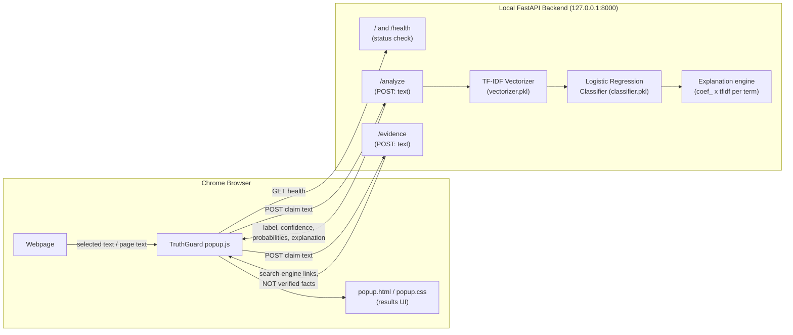

# 🛡️ TruthGuard — An Explainable AI Framework for Online Misinformation Detection and Mitigation

TruthGuard is a Chrome browser extension backed by a local FastAPI + scikit-learn
service. It classifies short claims using a six-class model trained on the LIAR
political-claims dataset, and — unlike a black-box "true/false" verdict — it
shows **which words actually drove the prediction**, so the result can be
inspected rather than blindly trusted.

> **This is a B.Tech final-year academic prototype, not a production
> fact-checking service.** Its accuracy is modest (see [Model Performance](#model-performance)
> below) and it is scoped to short political-style claims. Read
> [Limitations](#limitations--honest-disclaimers) before using or demoing it.

---

## 1. Project Objectives

1. Detect potentially misleading short claims using a transparent, classical
   ML pipeline (TF‑IDF + Logistic Regression) rather than an opaque model.
2. Make the model **explainable**: every prediction is accompanied by the
   actual words from the input that pushed the score toward or away from the
   predicted class.
3. Deliver this as a practical, everyday tool: a Chrome extension that can
   analyze either the full text of the current webpage or a user-selected
   snippet.
4. Be honest about uncertainty: confidence scores, input-length warnings, and
   a visible disclaimer are shown on every result instead of a bare label.

---

## 2. Architecture & Request Flow



**Request flow for "Analyze Page" / "Check Selected Text":**

1. `popup.js` runs `chrome.scripting.executeScript` in the active tab to read
   either `document.body.innerText` or `window.getSelection().toString()`.
2. The extracted text (trimmed, capped at 20,000 characters) is POSTed to
   `http://127.0.0.1:8000/analyze`.
3. FastAPI vectorizes the text with the fitted `TfidfVectorizer`, scores it
   with the fitted `LogisticRegression` model, and computes per-word
   contributions from the terms actually present in the text.
4. The popup renders the label, confidence bar, full six-class probability
   breakdown, and the explainability panel (top positive/negative terms).
5. Separately, the popup calls `/evidence`, which returns ready-made search
   links (Google Fact Check Explorer, Google, Snopes, PolitiFact) built from
   the claim text — clearly labeled as manual lookup shortcuts, not automated
   verification (see [Phase E / Evidence](#5-evidence-layer-whats-real-and-whats-not)).

---

## 3. Technology Stack

| Layer | Technology |
|---|---|
| Text classification | TF‑IDF (`TfidfVectorizer`) + Logistic Regression (scikit-learn) |
| Dataset | [LIAR dataset](https://www.cs.ucsb.edu/~william/data/liar_dataset.zip) (Wang, 2017) — short political claims, 6 labels |
| Backend API | Python 3.11, FastAPI, Uvicorn |
| Model serialization | joblib (`.pkl`) |
| Browser extension | Chrome Manifest V3, vanilla HTML/CSS/JavaScript |
| Testing | pytest + FastAPI `TestClient` |

---

## 4. Repository Structure

```
TruthGuard/
├── backend/
│   ├── app.py                   # FastAPI app: /, /health, /analyze, /evidence
│   ├── requirements.txt         # Backend Python dependencies
│   ├── model/
│   │   ├── vectorizer.pkl       # Fitted TfidfVectorizer
│   │   ├── classifier.pkl       # Fitted LogisticRegression (6 classes)
│   │   ├── labels.json          # Ordered class labels
│   │   └── test_metrics.json    # Auto-generated by evaluate_model.py
│   ├── training/
│   │   ├── train_model.py       # Trains on train.tsv, validates on valid.tsv
│   │   └── evaluate_model.py    # Final honest check against held-out test.tsv
│   ├── tests/
│   │   └── test_app.py          # Automated backend test suite (pytest)
│   └── data/                    # LIAR dataset .tsv files (NOT committed — see below)
├── extension/
│   ├── manifest.json            # Manifest V3 config
│   ├── popup.html / .css / .js  # Extension popup UI + logic
├── .gitignore
└── README.md
```

`backend/data/` is intentionally excluded from git (`.gitignore`) because the
LIAR dataset has its own distribution terms from the original authors — you
fetch it yourself (instructions below) rather than TruthGuard redistributing
it.

---

## 5. Setup on Linux Mint

### 5.1 Prerequisites

```bash
sudo apt update
sudo apt install -y python3 python3-venv python3-pip git
```

Google Chrome or any Chromium-based browser (for the extension).

### 5.2 Clone and set up the backend

```bash
cd ~/Downloads/TruthGuard
python3 -m venv backend/venv
source backend/venv/bin/activate
pip install --upgrade pip
pip install -r backend/requirements.txt
```

### 5.3 (Optional) Re-train the model

The repository already ships trained artifacts in `backend/model/`, so this
step is **optional** — only needed if you want to retrain from scratch or
reproduce the metrics below.

1. Download the LIAR dataset:
   ```bash
   mkdir -p backend/data
   cd backend/data
   curl -LO https://raw.githubusercontent.com/thiagorainmaker77/liar_dataset/master/train.tsv
   curl -LO https://raw.githubusercontent.com/thiagorainmaker77/liar_dataset/master/valid.tsv
   curl -LO https://raw.githubusercontent.com/thiagorainmaker77/liar_dataset/master/test.tsv
   cd ../..
   ```
2. Train (fits on `train.tsv`, reports metrics on `valid.tsv`, saves to
   `backend/model/`):
   ```bash
   python backend/training/train_model.py
   ```
3. Get an honest, final read on the **held-out** `test.tsv` (never touched
   during training):
   ```bash
   python backend/training/evaluate_model.py
   ```

### 5.4 Start the backend

```bash
source backend/venv/bin/activate
cd backend
uvicorn app:app --host 127.0.0.1 --port 8000 --reload
```

Verify it's alive:

```bash
curl http://127.0.0.1:8000/
```

Expected response:

```json
{
  "status": "ok",
  "service": "TruthGuard API",
  "version": "1.3.0",
  "model_loaded": true,
  "classes": ["barely-true","false","half-true","mostly-true","pants-fire","true"],
  "model_error": null
}
```

Leave this terminal running while you use the extension — the extension
talks to `http://127.0.0.1:8000` directly, it does not start the backend
for you.

### 5.5 Install the Chrome extension

1. Open `chrome://extensions`.
2. Enable **Developer mode** (top-right toggle).
3. Click **Load unpacked**.
4. Select the `extension/` folder inside this repository.
5. Pin the TruthGuard icon to the toolbar (optional, for convenience).

### 5.6 Using it

- **Analyze a whole page:** open any article, click the TruthGuard icon,
  click **"📄 Analyze Page"**.
- **Analyze selected text:** highlight a sentence/paragraph on any webpage,
  click the TruthGuard icon, click **"✂️ Check Selected Text"**.
- The popup shows: a predicted label badge, a plain-language description, a
  confidence bar, the full 6-class probability breakdown (collapsible), the
  explainability panel with the actual words that pushed the prediction up or
  down (collapsible), and manual "check further" search links (collapsible).
- If the backend isn't running, the status dot turns red and clicking either
  button shows a clear "backend unavailable" error instead of a fake result.

---

## 6. API Reference

Base URL: `http://127.0.0.1:8000`

### `GET /` and `GET /health`

Health check used by the extension's status indicator.

```json
{
  "status": "ok",
  "service": "TruthGuard API",
  "version": "1.3.0",
  "model_loaded": true,
  "classes": ["barely-true","false","half-true","mostly-true","pants-fire","true"],
  "model_error": null
}
```

### `POST /analyze`

Request:
```json
{ "text": "The unemployment rate dropped to a 50-year low this year." }
```

Response (truncated):
```json
{
  "claim": "the unemployment rate dropped to a 50-year low this year.",
  "label": "half-true",
  "label_description": "Rated HALF TRUE — partially accurate, leaves out important details.",
  "confidence": 0.3525,
  "class_probabilities": {
    "barely-true": 0.1052, "false": 0.17, "half-true": 0.3525,
    "mostly-true": 0.1841, "pants-fire": 0.0989, "true": 0.0895
  },
  "explanation": {
    "available": true,
    "predicted_class": "half-true",
    "positive_clues": [{ "term": "administration", "contribution": 0.12108 }, "..."],
    "negative_clues": [{ "term": "this administration", "contribution": -0.06162 }, "..."],
    "note": "These are model feature contributions ... not verified evidence."
  },
  "word_count": 15,
  "input_warning": null,
  "caution": "This is a machine-learning prediction ... not a fact-check."
}
```

Edge cases, all handled without crashing or faking a result:
- Empty / whitespace-only text → `label: "uncertain"`, `confidence: 0.0`, HTTP 200.
- Text longer than 200,000 characters → HTTP 422 (payload rejected).
- Text over ~100 words → `input_warning` explains the model is out of its
  intended operating range.
- Model failed to load → `label: "unavailable"`, `caution` explains why, HTTP 200.
- Unexpected inference error → `label: "error"`, `caution` explains why, HTTP 200
  (never silently returns a fabricated prediction).

### `POST /evidence`

Returns ready-to-open search links built from the claim text — **not**
automated fact-check results (see next section).

```json
{
  "available": true,
  "query": "The moon landing was faked",
  "sources": [
    { "name": "Google Fact Check Explorer", "url": "https://toolbox.google.com/factcheck/explorer/search/..." },
    { "name": "Google Search", "url": "https://www.google.com/search?q=..." },
    { "name": "Snopes", "url": "https://www.snopes.com/?s=..." },
    { "name": "PolitiFact", "url": "https://www.politifact.com/search/?q=..." }
  ],
  "note": "These are search links generated from your text, not automated fact-check results..."
}
```

---

## 7. Explainability Mechanism (XAI)

TruthGuard uses **exact linear attribution**, not an approximation:

- For a fitted `TfidfVectorizer` + `LogisticRegression`, the score for class
  *c* is `score(c) = Σ (tfidf_weight(term) × coefficient(term, c))` summed
  over the vocabulary.
- For each term that actually appears in the input, TruthGuard computes its
  exact contribution to the predicted class's score and sorts terms by
  contribution.
- The top 8 positive and top 8 negative contributing terms are returned.
- Because this is a direct read-out of the model's own linear math (not
  LIME/SHAP-style sampling), it is 100% faithful to what the model actually
  computed — there is no approximation error.
- **This method is only valid for linear models.** If TruthGuard's classifier
  is ever swapped for a non-linear model (e.g. gradient boosting, a neural
  network), `build_explanation()` in `backend/app.py` must be replaced with a
  method appropriate for that model family (e.g. SHAP, LIME, integrated
  gradients) — it is explicitly documented in code as such.
- **What this does *not* mean:** a word contributing positively to "false"
  does not mean that word is factually wrong — it means the model's training
  data statistically associated that word/phrase with the "false" label.
  Explanations describe the model's reasoning, not objective truth.

---

## 8. Model Performance

Measured on the real LIAR dataset splits on **this exact codebase**
(`backend/training/train_model.py` fit on `train.tsv`; metrics below from
`backend/training/evaluate_model.py` on the **held-out** `test.tsv`, which is
never used for training or tuning):

| Split | Samples | Accuracy | Macro F1 | Weighted F1 |
|---|---|---|---|---|
| Validation (`valid.tsv`) | 1,284 | 24.07% | 0.2426 | 0.2395 |
| **Test (`test.tsv`, held-out)** | 1,283 | **24.63%** | **0.2446** | **0.2466** |

For context: random guessing across 6 roughly-balanced classes would score
**~16.7%** accuracy. This model is meaningfully better than chance but **far
from reliable** as a standalone fact-checker — this is consistent with
published results on the LIAR benchmark's hard 6-class setting (the original
LIAR paper reports similar text-only baselines in the 20s–20s%, improving
only with extensive speaker/metadata features this project does not use).

Full per-class precision/recall/F1 and the confusion matrix are printed by
`train_model.py` and `evaluate_model.py` each time they run, and a summary is
saved to `backend/model/test_metrics.json`.

**Why accuracy is capped around ~25%:** the LIAR dataset's six labels
(`true`, `mostly-true`, `half-true`, `barely-true`, `false`, `pants-fire`)
are genuinely difficult to separate from word choice alone — the difference
between "half-true" and "barely-true", for instance, often depends on facts
outside the sentence itself. This is a known, well-documented limitation of
the benchmark, not a bug in this implementation.

---

## 9. Testing

### Backend automated tests (18 tests, pytest)

```bash
source backend/venv/bin/activate
cd backend
pytest tests/ -v
```

**Actual result when last run in this environment: `18 passed`.** Coverage
includes:

- Model/vectorizer/labels load and are mutually consistent at import time.
- `/` and `/health` report `model_loaded: true` and the correct 6 classes.
- Empty string and whitespace-only input handled gracefully (HTTP 200,
  `label: "uncertain"`), never faked as a real prediction.
- Missing `text` field treated as empty text (no hard crash).
- Wrong type for `text` (e.g. a number) → HTTP 422.
- Oversized text (>200,000 chars) → HTTP 422.
- A normal claim returns a label in the valid class set and confidence in `[0, 1]`.
- Class probabilities are finite, non-negative, and sum to ~1.0.
- Explanation fields (`available`, `positive_clues`, `negative_clues`, `note`)
  are always present and well-typed.
- Every term in an explanation is verified to actually exist in the fitted
  vectorizer's vocabulary (proves explanations are read from the real model).
- Out-of-vocabulary text correctly reports `explanation.available: false`.
- Long text (>100 words) triggers `input_warning`; short claims do not.
- `/evidence` returns real, well-formed URLs and explicitly says results are
  not automated fact-checks.
- Simulated missing/corrupted model artifacts (via monkeypatching) produce a
  clear `"unavailable"` response instead of crashing.

### Extension checks performed

- `node --check extension/popup.js` → syntax OK.
- `extension/manifest.json` validated as well-formed JSON with Manifest V3
  schema fields.
- Manual backend integration verified with `curl` against a running server
  for: health check, normal claim, empty/whitespace text, malformed JSON,
  oversized text, out-of-vocabulary text, and long-text warnings — all
  behaved as documented above.

### What could not be automated in this environment

Real interactive Chrome testing (loading the unpacked extension and clicking
through the UI in an actual browser window) requires a graphical Chrome
instance, which is not available in this development environment. The
shortest manual verification procedure:

1. Follow [5.5 Install the Chrome extension](#55-install-the-chrome-extension).
2. Start the backend (`5.4`).
3. Open any news article, select a sentence, click the TruthGuard icon →
   "Check Selected Text" → confirm a result card appears with a label,
   confidence bar, probability list, and explanation terms.
4. Click "Analyze Page" on the same article → confirm a (possibly different)
   result appears, and an `input_warning` is shown if the page is long.
5. Stop the backend (`Ctrl+C` in its terminal) and repeat step 3 → confirm
   the popup shows a clear "Backend request failed" error instead of
   crashing or hanging.

---

## 10. Security & Repository Hygiene

- **CORS**: `allow_origins=["*"]` is deliberately permissive because the
  extension calls the API from a `chrome-extension://` origin with no fixed
  hostname. This is acceptable for a **local-only, localhost-bound**
  development server. If you ever deploy this backend beyond `127.0.0.1`,
  restrict CORS to the real extension origin and add authentication.
- **Host permissions**: `extension/manifest.json` only requests
  `http://127.0.0.1:8000/*`, `activeTab`, and `scripting` — no broad
  `<all_urls>` host permission and no background persistent script.
- **Dead code removed**: the extension's old unused `content.js` content
  script (which injected into every page via `<all_urls>` but was never
  actually called) has been removed entirely, shrinking the permission
  surface.
- **Input limits**: text is capped at 200,000 characters server-side and
  20,000 characters client-side before sending, preventing pathological
  payloads.
- **No secrets**: no API keys are used or required anywhere in this project.
  `.gitignore` excludes `.env`, virtual environments, caches, and the
  (non-redistributable) LIAR dataset files.
- **No fabricated results**: both `/analyze` and `/evidence` are written so
  that a backend failure, missing model, or lack of evidence always returns
  an explicit, honest status — never a default/fallback value dressed up as
  a real prediction.
- Stale files `backend/app.py.backup` and `backend/app.py.xai-backup`
  (superseded, partial earlier iterations of `app.py`) were removed from the
  working tree — they remain recoverable from git history if ever needed.

---

## 11. Limitations & Honest Disclaimers

- **Scope**: the model is trained on short, single-sentence political claims
  (LIAR dataset, ~2012–2016 US political statements). It was not trained on,
  and should not be trusted for, full news articles, health claims, financial
  claims, scientific claims, or non-English text. `/analyze` detects and
  warns when input is much longer than the model's training distribution,
  but a warning is not a guarantee of correctness either way.
- **Accuracy**: ~24–25% accuracy on 6 classes (vs. ~16.7% random baseline).
  This is a research-grade baseline, not a reliable verdict. Confidence
  scores reflect the model's own certainty about its classification — they
  are **not** the probability that a claim is objectively true.
- **Explanations describe the model, not the world**: influential words are
  statistical associations learned from training data, not evidence that a
  claim is actually true or false.
- **Evidence links are not verification**: `/evidence` only builds search
  URLs from the claim text. TruthGuard does not fetch, read, or evaluate the
  content behind those links, and cannot vouch for the reliability of any
  site returned by a search engine.
- **No internet fact-checking API is used.** No API key is required or
  assumed anywhere in this project.

## 12. Future Improvements

- Add metadata features (speaker, party, historical truthfulness counts) as
  in the original LIAR paper to improve accuracy beyond text-only baselines.
- Add a calibration step (e.g. Platt scaling / temperature scaling) so
  confidence values better reflect true likelihood of correctness.
- Add a real, licensed fact-check API (e.g. Google Fact Check Tools API) as
  an optional, clearly-labeled enhancement to `/evidence`, falling back to
  the current search-link behavior when no key is configured.
- Package the backend as a background-launched local service so the
  extension doesn't require a manually-started terminal.
- Explore a lightweight transformer-based classifier with a corresponding
  explanation method (e.g. attention-based or SHAP-based) if a larger
  labeled misinformation dataset becomes available.

---

## 13. Credits

- Dataset: Wang, W. Y. (2017). *"Liar, Liar Pants on Fire": A New Benchmark
  Dataset for Fake News Detection.* ACL 2017.
- Author: Final-year B.Tech CSE project, TruthGuard.
